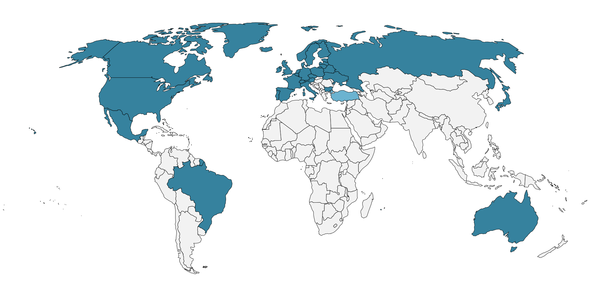

# Holiday

This project is an independently maintained fork of umulmrum/holiday, originally created by Stefan Kruppa.
It aims to continue development, maintain compatibility, and support modern PHP versions.

Holiday is a library that computes holidays in a very flexible way. It is possible to filter holiday lists by various
criteria and format them in different ways. It is easy to add more holiday providers, filters and formatters, so even
if this library does not perfectly fit your needs, you can simply extend it.

[](https://packagist.org/packages/alianet/holiday) [](https://packagist.org/packages/alianet/holiday) [](https://packagist.org/packages/alianet/holiday) [](https://codecov.io/gh/alianet/holiday)

## Requirements

- PHP >= 8.2

That's it really.

## Installation

Install the library using Composer.

```
composer require alianet/holiday
```

## Usage Examples

Simple example:

```php
<?php

require 'vendor/autoload.php';

use Umulmrum\Holiday\HolidayCalculator;
use Umulmrum\Holiday\Provider\Germany\Bavaria;

$holidayCalculator = new HolidayCalculator();
$holidays = $holidayCalculator->calculate(Bavaria::class, 2020);
```

This results in a `HolidayList` which contains all holidays for 2020; this list can then be used for output or further
computation. Holidays are always computed for one full year and can then be narrowed down using filters.

More complex example:

```php
<?php

require 'vendor/autoload.php';

use Umulmrum\Holiday\HolidayCalculator;
use Umulmrum\Holiday\Filter\IncludeTimespanFilter;
use Umulmrum\Holiday\Formatter\DateFormatter;

$holidayCalculator = new HolidayCalculator();
$holidays = $holidayCalculator->calculate('DE-BY', 2020);
// Apply filters, e.g. restrict to one month.
$firstDay = new \DateTime('2020-12-01');
$lastDay = new \DateTime('2020-12-31');
$holidays = $holidays->filter(new IncludeTimespanFilter($firstDay, $lastDay));
// Format the results.
$formattedHolidays = $holidays->format(new DateFormatter());
```

This results in an array of date strings. Note that we used the ISO-3166-2 code `DE-BY` to get the holidays for Bavaria.
See section `Resolving Holiday Providers` below for different ways to request holidays.

There are also some helper methods that simplify some common holiday computations. Using the `GetHolidayForMonth` helper,
the example above can be substituted by this:

```php
<?php

require 'vendor/autoload.php';

use Umulmrum\Holiday\Formatter\DateFormatter;
use Umulmrum\Holiday\Helper\GetHolidaysForMonth;
use Umulmrum\Holiday\Provider\Germany\Bavaria;

$formattedHolidays = (new GetHolidaysForMonth())(Bavaria::class, 2020, 12)->format(new DateFormatter());
```

One last example shows how to compute all holidays, Saturdays and Sundays in the years 2020 and 2021 for the German state
Baden-Wuerttemberg, sort these holidays by date and format the result as JSON (all in 2 lines of code):

```php
<?php

require 'vendor/autoload.php';

use Umulmrum\Holiday\HolidayCalculator;
use Umulmrum\Holiday\Filter\SortByDateFilter;
use Umulmrum\Holiday\Formatter\JsonFormatter;
use Umulmrum\Holiday\Provider\Germany\BadenWuerttemberg;
use Umulmrum\Holiday\Provider\Weekday\Saturdays;
use Umulmrum\Holiday\Provider\Weekday\Sundays;

$calculator = new HolidayCalculator();
$holidays = $calculator->calculate([BadenWuerttemberg::class, Saturdays::class, Sundays::class], [2020, 2021]);
$formattedHolidays = $holidays->filter(new SortByDateFilter())->format(new JsonFormatter());
```

## Detailed Usage

First create a `HolidayList` for holidays in one or more years by using the `HolidayCalculator`. Pass one or more holiday
providers to the calculator to get holidays for these providers, e.g. a country, a religion or event a specific weekday.
`HolidayList` is basically an augmented array of `Holiday` objects.

```php
use Umulmrum\Holiday\HolidayCalculator;
use Umulmrum\Holiday\Provider\Luxembourg\Luxembourg;
use Umulmrum\Holiday\Provider\Weekday\Saturdays;
use Umulmrum\Holiday\Provider\Weekday\Sundays;

$calculator = new HolidayCalculator();
$holidays = $calculator->calculate(Luxembourg::class, 2020);

// or multiple providers at once by passing an array of providers
$holidays = $calculator->calculate([Luxembourg::class, Saturdays::class, Sundays::class], 2020);

// or multiple years at once by passing an array of years (can be combined)
$holidays = $calculator->calculate(Luxembourg::class, [2020, 2021]);
```

See the complete list of built-in providers under `src/Provider` or use them as examples to create your own. Be aware that
a holiday is NOT equivalent to a day off - holidays in the sense of this lib is more of a "special day" as defined by
providers, and might be traditional or religious days without impact on working hours. To restrict a `HolidayList` to
days off, use the `IncludeTypeFilter` as described below in the `Filters` section.

The `HolidayList` can then be asked for information or holidays can be added or removed, the list can be filtered or formatted.

```php
// Get the number of holidays in the list. HolidayList also implements \Countable
$holidays->count();
```

```php
// Get the list of holidays as array. HolidayList also implements \IteratorAggregate
$holidays->getList();
$holidays->getIterator();
$holidays->getByName($holidayName)
```

```php
// Modify the list.
$holidays->add($anotherHoliday);
$holidays->addAll($anotherHolidayList);
$holidays->removeByName($holidayName);
$holidays->removeByIndex(3);
$holidays->replaceByNameAndDate($anotherHoliday);
$holidays->replaceByIndex(0, $anotherHoliday);
```

```php
// Check if a given date is in the list
$holidays->isHoliday(new \DateTime('2020-12-01'));
```

### Resolving Holiday Providers

The examples above already showed two different ways to specify for which region or other "entity" holidays should be
calculated. There are more ways, and complete customization is also possible - let's have a look at all of them:

1. Fully qualified class name:

    ```php
    $calculator->calculate(\Umulmrum\Holiday\Provider\France\France::class, 2020);
    ```
    
    This is suggested as default, since you only need to remember the region to request and IDEs should provide
    autocompletion to save keystrokes.

2. Instantiated class:

    ```php
    $calculator->calculate(new \Umulmrum\Holiday\Provider\Weekday\Sundays(\Umulmrum\Holiday\Constant\HolidayType::DAY_OFF), 2020);
    ```
    
    Use an instantiated class of the same type as you would specify when using way 1. Do this if a provider has constructor
    arguments, such as additional holiday types as seen in the example (Sundays aren't automatically days off).

3. ISO-3166 names:

    ```php
    $calculator->calculate('AT-9', 2020); // AT-9 = Vienna in Austria
    ```
    
    Use ISO-3166-1 country codes or ISO-3166-2 region codes e.g. if your application already uses them to simplify integration
    and decoupling of the Holiday lib. The list of supported countries and regions can be found in `src/Resolver/isoData.php`.
    There is a fallback to the base country in case the region code is not found - see the comment in the `IsoResolver`
    class for details.

4. Misc abbreviations:

    ```php
    $calculator->calculate('Christian', 2020);
    ```

    Additional short strings are defined in the `MiscResolver` class. Those are `Christian` for Christian holidays, as
    well as `Sun`, `Mon`, `Tue`, `Wed`, `Thu`, `Fri`, and `Sat` for the days of the week.

5. Custom

    ```php
    $calculator = new \Umulmrum\Holiday\HolidayCalculator(new \Umulmrum\Holiday\Resolver\ResolverHandler([new MyCustomResolver()]));
    ```
    
    Use this to add custom resolving logic. `ResolverHandler` takes an array of `ProviderResolverInterface`s (and implements
    `ResolverHandlerInterface`, so can even be exchanged with more custom code).

### Filters

Use filters to narrow down the list of holidays to the desired subset.

```php
use Umulmrum\Holiday\Constant\HolidayType;
use Umulmrum\Holiday\Filter\IncludeTimespanFilter;
use Umulmrum\Holiday\Filter\IncludeTypeFilter;

// Keep only work-free days (as defined in the provider(s) the list is derived from).
$holidays->filter(new IncludeTypeFilter(HolidayType::DAY_OFF));

/*
 * Filters modify the original list. The following example shows how to chain filters to get holidays with type DAY_OFF
 * in January 2020.
 */
$holidays
    ->filter(new IncludeTimespanFilter(new \DateTime('2020-01-01'), new \DateTime('2020-01-31')))
    ->filter(new IncludeTypeFilter(HolidayType::DAY_OFF))
;
```

`IncludeWeekdayFilter`, `IncludeHolidayNameFilter`, and `IncludeTypeFilter` accept
separate values, for example `new IncludeWeekdayFilter(Weekday::MONDAY, Weekday::FRIDAY)`.
Unpack an existing array with `new IncludeWeekdayFilter(...$weekdays)`.
Constructors use typed variadic parameters (`int` for weekdays/types, `string` for
names). Invalid argument types raise `TypeError`; PHP may coerce scalar values when
the calling file does not enable `strict_types`. Weekdays outside 0–6 raise
`InvalidArgumentException`.
Weekday filters require at least one value. Empty name/type filters match nothing.

See the complete list of built-in filters under `src/Filter` or use them as examples to create your own (extend
`AbstractFilter` or implement `HolidayFilterInterface`).

### Formatters

Use formatters to - you guessed it - format `HolidayList`s and `Holiday`s.

```php
use Umulmrum\Holiday\Formatter\JsonFormatter;

$formattedList = $holidayList->format(new JsonFormatter());
```

Formatters may return a string or an array of strings.

See the complete list of built-in formatters under `src/Formatter` or use them as examples to create your own (implement
`HolidayFormatterInterface`).

### Holiday Types

A `HolidayList` contains `Holiday` objects. Apart from a (technical) name and date, each holiday has one or more types.
Return these types as an integer bit mask by calling `Holiday::getType()`, or ask for specific types using
`Holiday::hasType()`.

The type is normally a combination of
- the holiday's origin, e.g. religious or traditional,
- the holiday's legal status (official or not),
- the holiday's impact on working hours (e.g. if it's a full or half day off, if schools or government agencies are closed).

See the `HolidayType` class for available types. This class also contains translation keys for these types
which can then get translated for localized readable names - see e.g. `JsonFormatter` for details.

### Which Holidays are Returned

`HolidayCalculator` only returns holidays that are legally defined in the scope of the chosen holiday provider, or
if there's "secular impact", e.g. it's a day off. This means there are differences between providers; e.g. Easter Sunday
is an official holiday in Brandenburg/Germany, so it is included for Brandenburg. In the rest of Germany (as well as 
most other countries) it is not a holiday as it is a Sunday anyway, and therefore not included as a holiday.

Similarly, Sundays are normally not included if they are no official holidays in the scope of the holiday provider,
although they are days off in the Western hemisphere. To find out which days are days off, provide both the respective
holiday provider and the one for Sundays (or use `GetNoWorkDaysForTimeSpan()`).

If your use case requires other holiday lists, consider combining multiple providers (e.g. `Switzerland` and
`ChristianHolidays`), or remove some using filters (e.g. combine `IncludeTypeFilter` and `InverseFilter`) to remove
Sundays from `Brandenburg` lists.

### Translations

Each holiday will be provided with a technical name that resembles the English name, e.g. `new_year`. To translate these
technical names into spoken languages, use the `Translator`. This class comes with English, German, Norwegian and Polish
translations of holiday names, but other languages can be added (contributions welcome, but translation files can also be
outside this library).

The `TranslateFilter` can replace the names of all holidays in a `HolidayList` at once. Use it like this:

```php
use \Umulmrum\Holiday\Filter\TranslateFilter;

$holidayList->filter(new TranslateFilter(locale: 'en'));
```

The `TranslateFilter` uses the `Translator` with the built-in translations internally, but this can be customized - see
the constructors of the used classes.

Some formatters such as the `JsonFormatter` can also be initialized with an optional translator.

The `Translator` uses two levels of fallback for the passed locale:

- First, it tries to find the translation for the exact locale, e.g. `en_US`.
- If it isn't found, it tries the base language, e.g. `en`.
- If this is also not found, it tries the passed fallback language, which is configurable (default `en`).
- If this is also not found, it returns the empty string.

The translation files can be found under `res/trans`. They are written in PHP, compatible with the Symfony Translation
component, so they can be directly loaded using Symfony's `PhpFileLoader`.

There is also a `SymfonyBridgeTranslator` which enables usage of an existing Symfony translator (translation files need
to be registered separately).

### Helpers

To simplify some common holiday-related tasks, see the helpers under `src/Helper` (e.g. the `GetNoWorkDaysForTimeSpan`
helper takes holiday providers and a timespan and calculates a list of all days off for these arguments).
 
## Supported Calendars

Currently only the Gregorian calendar is supported, for years from 1 to 9999 (inclusive).
 
## Supported Countries



(map created by simplemaps.com - licensed under MIT)

- Australia
- Austria (incl. Burgenland, Carinthia, Lower Austria, Salzburg, Styria, Tyrol, UpperAustria, Vienna, Vorarlberg)
- Belarus
- Belgium
- Brazil
- Bulgaria
- Canada
- Czech Republic
- Denmark
- Estonia
- Finland
- France (incl. Bas-Rhin, French Guiana, Guadeloupe, Haut-Rhin, Martinique, Moselle, Reunion)
- Germany (incl. Baden-Wuerttemberg, Bavaria, Berlin, Brandenburg, Bremen, Hamburg, Hesse, Lower Saxony, Mecklenburg-Vorpommern, North-rhine Westphalia, Rhineland Palatinate, Saarland, Saxony, Saxony-Anhalt, Schleswig-Holstein, Thuringia)
- Greenland
- Iceland
- Ireland
- Italy (incl. South Tyrol)
- Latvia
- Liechtenstein
- Lithuania
- Luxembourg
- Mexico
- The Netherlands
- Norway
- Poland
- Portugal (incl. Azores, Madeira, without municipal holidays)
- Russia
- Spain (common holidays only yet)
- Sweden
- Switzerland (incl. Aargau, Appenzell-Ausserrhoden, Appenzell-Innerrhoden, Basel Landschaft, Basel Stadt, Bern, Fribourg, Geneva, Glarus, Grisons, Jura, Lucerne, Neuchatel, Nidwalden, Obwalden, Schaffhausen, Schwyz, Solothurn, St Gallen, Thurgau, Ticino, Uri, Valais, Vaud, Zuerich, Zug)
- Turkey (without Islamic holidays yet)
- Ukraine
- United Kingdom (incl. England, Northern Ireland, Scotland (without local holidays), Wales; mainland only yet)
- USA (federal calendar, all 50 states and Washington, DC; state calendars follow python-holidays public-holiday scope)

To create your own holiday providers have a look at the existing code, it should be self-explanatory. I will happily
merge pull requests to support more countries (see below).

### Notes on US state holidays

`US` retains the existing federal provider. Use `US-CA`, `US-TX`, etc. for a complete
state public calendar, or `US-DC` for Washington, DC. Named providers such as
`Provider\Usa\California` and `Provider\Usa\Texas` are also available.

```php
$calculator = new \Umulmrum\Holiday\HolidayCalculator();
$state = $calculator->calculate('US-CA', 2026);
$combined = $calculator->calculate(['US', 'US-CA'], 2026);
```

A state calendar is complete within its public-holiday scope; it does not require
adding `US`. Passing both requests a union, which keeps federal holidays even when
absent from the state calendar. Matching date/identifier pairs are deduplicated.
Each provider applies its own substitute-day rules before calendars are combined.
State-specific rules live in the named provider classes. Their shared `State` base
provides common holidays, date helpers and substitute-day calculations. Shared dates
come from `CommonHolidaysTrait`, `ChristianHolidaysTrait` and `UsaHolidaysTrait`;
providers retain the year limits, state exceptions and observed-day rules.
Calling `calculateHolidaysForYear()` directly returns original dates; use the
`HolidayCalculator` to include substitute days.

State calendars follow the public category of python-holidays 0.109, including its
historical rules and naming conventions. They are marked `OFFICIAL` and `PARTIAL_ONLY`;
the upstream public category alone does not establish universal `DAY_OFF` entitlement
or `GOVERNMENT_AGENCIES_CLOSED`. Substitute dates additionally have `COMPENSATORY`. Reference coverage is 2020–2026; earlier/later rules have not
been comprehensively checked against official state calendars. California's Diwali
uses a lunar-date table through 2100 and explicitly rejects years after 2100.
Territories and employer-specific calendars are excluded.

### Notes on Canadian Holidays

- Holidays in Canada were hard to grasp while adding (for a non-Canadian). There are multiple levels of flexibility in
  the holidays (differences betweeen provinces/territories, role of government/private sector, negotiatability of
  substitue holidays). So the current state surely is not perfect and further proposals are highly welcome.

### Notes on German Holidays

- Easter Sunday/Ostersonntag and Whit Sunday/Pfingstsonntag are not public holidays in most states.
- Every Sunday is a public holiday in Hesse.
- Assumption/Mariä Himmelfahrt is a public holiday in about 1700 of about 2000 communities in Bavaria. This is 
  implemented as a partial holiday, so you might want to add your logic that filters this date.
- In Bavaria schools are closed on Assumption Day and on Repentance and Prayer Day. There is no special handling of
  this "behavior".
- Corpus Christi/Fronleichnam is a public holiday in some communities in Saxony and Thuringia.
- Regional holidays with traditionally (but not publicly) limited opening hours are not considered yet (e.g. carnival 
  days).
- Some ports at the German Ocean celebrate some holidays as "High Holidays". It is generally not allowed to work on 
  these days, and work time ends at 12 o'clock the day before. This is not considered yet.
- Also there are some quiet days that are not public holidays in various states. This is also not considered yet.
- New states of Germany are treated as if they had always been part of the Federal Republic of Germany. For years
  before 1990 holidays are therefore not correct.

### Notes on Swiss Holidays

- Holidays in Switzerland are really complicated as there is wide fragmentation on if or how holidays are celebrated.
  The implemented rules are a best guess of what makes sense in the scope of this library (written by someone who isn't
  from Switzerland). I'm open for improvements.

### Notes on Ukrainian Holidays

- Ukraine has been using the Revised Julian calendar in recent years. This calendar is not directly supported, but it is
  identical to the Gregorian calendar up to the year 2800.
- Years in which Easter falls on Sunday, May 1st (e.g. 2016) seem to be unclear regarding compensatory holidays. Treat
  those years with a grain of salt.

### Notes on Christian Holidays

- Only the most important holidays are taken into account, as interpreted by me (which is most likely far from accurate; 
  please feel free to contribute changes).

### Notes on Christian Orthodox Holiday

- Orthodox Easter is calculated in the Julian calendar and converted to the Gregorian calendar using the offset for
  the given century. Holidays relative to Easter use the converted date.

### Note on Holidays Way in the Past or Future

If computing holidays for past years, be aware that they may not be accurate. All holidays were introduced at some 
point in time, so this lib might return holidays for years in which they really were not in existence, as well as omit
holidays that haven't been celebrated for a long time.
 
Likewise holidays might of course change in the future. Also, Easter date calculation will change in the far future due 
to astronomical reasons.

This lib aims to be accurate for "recent" years at least, approximately for years after World War II until present.
Again, contributions are welcome.

## Versioning

This library follows Semantic Versioning. Everything in the library can be considered the public API except:
 - code annotated with `@internal`,
 - tests,
 - code that can only be accessed by using reflection (e.g. private methods). 

 Note that the library is still in a 0.* version which allows the public API to change anytime.

## Contribution

Contributions are highly welcome. Please follow these rules when submitting a PR:

- Mimic existing code for style and structure.
- Add unit tests for all of your code; run the tests locally by calling `composer test`.
- Ideally, also run `composer analyze` and fix any reported errors.
- At the end, fix the code style by calling `composer cs` (you can omit this if you're in a hurry).

By submitting a PR you agree that all your contributed code may be used under the MIT license.

### Testing on multiple PHP versions

GitHub Actions generates Clover coverage reports and uploads the PHP 8.5 report to
[Codecov](https://codecov.io/gh/alianet/holiday). To enable uploads, activate the repository
in Codecov and add its upload token as the `CODECOV_TOKEN` GitHub Actions repository secret.

With Docker and Bash installed, run tests and static analysis on PHP 8.2, 8.3, 8.4 and 8.5:

```bash
./tools/test-php-versions
```

To check a single version:

```bash
./tools/test-php-version 8.4
```

The supported versions are listed in `tools/php-versions`, matching the CI matrix.
Each run installs dependencies for the selected PHP version in an isolated Docker image,
runs `composer test` with PCOV coverage and `composer analyze`, then removes the image.
Local dependencies are unchanged. The full matrix prints a PASS/FAIL summary and returns
a nonzero exit code if any version fails.

QA builds share a persistent BuildKit cache for Composer downloads and limit HTTP
downloads to two concurrent requests. Failed installs are retried twice, after
15 and 30 seconds, to handle temporary download errors such as HTTP 429.

### Adding Tests

Provide tests inside `tests/Provider/...` that ideally cover all edge cases. This can be done as follows:

- First write the changes to the holiday provider itself
- Then run a command that looks approximately like this: `tests/console test:generate DE-BY -y 2018 -y 2025`.
  Replace `DE-BY` with the ISO code of your new provider.
  Replace `-y 2018 -y 2025` with the years that make sense for your provider.
- The test will calculate holidays for the selected years and generate markdown tables that are saved in the
  directory `tests/Provider/Data`. Find the file there and check if you are content with the result, but don't
  change the format of the file, as the test runner will expect it exactly like this.
- Before you push your changes, add a line to the `tests/regenerateTests.sh` script; this is the same line you used
  for testing if you followed the steps above. This file allows rebuilding the tests on changes.
- If you need tests that can't be expressed like this (see e.g. Sweden), write those particular tests by hand.
- **Windows: Please note** On windows the generator must be run in a bash window.


### Independent reference tests

Reference tests compare provider dates and holiday identifiers with saved
[OpenHolidays API](https://www.openholidaysapi.org/en/) responses. They currently cover
PL, DE, DE-BE, CZ and AT for 2024 and 2025. Saved reference data is available for
all 36 countries currently listed by OpenHolidays, covering 2020–2025.
Tests run without network access:

```bash
php vendor/bin/phpunit tests/Reference/OpenHoliday
```

To refresh saved responses from OpenHolidays, GOV.UK and Azure, and regenerate US state
calendars, run from the project root with Composer development dependencies installed:

```bash
php tests/console test:reference:update
```

Updating requires internet access, PHP HTTPS stream support and `allow_url_fopen`.
The command updates OpenHolidays, GOV.UK, Azure and US state calendars in that order.
Download sources validate their responses before replacing data and updating retrieval time
and SHA-256 hashes in `sources.json` (OpenHolidays) or `source.json` (GOV.UK and Azure).
The US exporter records its pinned package version, generation time and JSON hash.
If a source fails, the command fails; previously completed updates remain on disk. The configured
countries, date range and name mappings are preserved. Review the data diff and run
the reference tests before committing; do not regenerate expected dates from providers.

See the [reference test documentation](tests/Reference/OpenHoliday/README.md) for
comparison scope, known classification differences, extending coverage and the ODbL
license applicable to the downloaded data.

An additional [GOV.UK reference suite](tests/Reference/GovUk/README.md) covers England
and Wales (`GB`), Scotland (`GB-SCT`) and Northern Ireland (`GB-NIR`) for 2019–2028,
including substitute days and exceptional bank holidays. Run or update it with:

```bash
php vendor/bin/phpunit tests/Reference/GovUk
php tests/console test:reference:govuk:update
```

The GOV.UK data is licensed under the Open Government Licence v3.0. Its updater
preserves the configured years and fails when the live feed no longer covers them.
To update only OpenHolidays, use `php tests/console test:reference:openholidays:update`.
The Docker update command below refreshes all four sources; its test command runs all suites.

The [Azure Open Datasets suite](tests/Reference/Azure/README.md) covers 24 supported country codes
for 2000–2020 (504 country/year cases) with a public Parquet snapshot, sourced from Python `holidays` and
Wikipedia. This is an archived reference, not a current calendar feed. Its JSON
extract is licensed under CC BY-SA 3.0; PHP tests run offline without Python.

**Azure's date range does not mean the data is current.** The dataset contains dates
from 1970 to 2099, including current and future years, but the pinned source file
was last modified on **6 December 2020**. Later dates reflect the rules captured in
that snapshot and may omit subsequent legal changes or one-off holidays. This is
why our Azure tests deliberately stop at 2020. Running the update command downloads
the same configured snapshot again; it does not obtain a newly maintained calendar.
Use OpenHolidays and current official sources such as GOV.UK to check recent years.

The original five countries retain full-calendar comparisons; the other countries
compare explicitly mapped shared identities. There are 471 agreement cases and
33 separately recorded unresolved discrepancies; a green test run does not mean
all providers agree with Azure. See the suite README for exclusions and exact gaps.
Updating Azure requires Python and PyArrow (included in the Docker target below):

```bash
php vendor/bin/phpunit tests/Reference/Azure
php tests/console test:reference:azure:update
```

The [US state reference calendars](tests/Reference/Usa/README.md) cover all 50 states
and DC for 2020–2026 using pinned MIT-licensed `python-holidays` data. There are 714
full-calendar comparisons of dates and holiday identities: actual dates and calendars
including substitute dates for every state/year. PHP rules are adapted from that
same upstream implementation; these are regression comparisons, not independent
verification against each state's legislation. Tests run offline without Python.
Update this source with `php tests/console test:reference:usa:update`.

#### Reference data with Docker

With Docker and Bash installed, run these commands from the project root. Build the
reference-updater image (PHP, Python and PyArrow) and install dependencies first
(both steps require internet access):

```bash
docker build --file docker/php/Dockerfile --target reference-updater \
  --build-arg PHP_VERSION=8.5 --tag holiday-php:8.5 .

docker run --rm --user "$(id -u):$(id -g)" \
  --env COMPOSER_HOME=/tmp/composer \
  --volume "$PWD:/app" --workdir /app holiday-php:8.5 \
  composer install --no-interaction --prefer-dist
```

Refresh the data with network access, then run the reference tests offline:

```bash
docker run --rm --user "$(id -u):$(id -g)" \
  --volume "$PWD:/app" --workdir /app holiday-php:8.5 \
  php tests/console test:reference:update

docker run --rm --network none --user "$(id -u):$(id -g)" \
  --volume "$PWD:/app" --workdir /app holiday-php:8.5 \
  php vendor/bin/phpunit tests/Reference --do-not-cache-result
```

The bind mount saves updated JSON files and metadata directly in your checkout.
The container runs with your user ID so newly written files belong to your user.
Reuse the image and installed dependencies for subsequent updates.

### How To Add a New Country or Region

- Add a provider for that country or region inside `src/Provider/...`.
- Should you need to add country-specific holiday names, add those to `Constant\HolidayName` and provide
  English translations inside `umulmrum_holiday.en.php`.
- Lookup the ISO code for your country or region and add it to `Resolver\isoData.php`. If you add a provider that does
  NOT add country data, please add it to the list in the `MiscResolver` class.
- If the country provides any form of substitute/compensatory holidays in case a holiday occurs on a weekend, proceed as
  follows:
  - Let the provider class implement `CompensatoryHolidayProviderInterface` instead of the default
    `HolidayProviderInterface`. Apart from that, add holidays without covering compensatory days at first.
  - Implement the method `getCompensatoryDaysCalculators` that should return an array of `CompensatoryDayCalculator`
    objects. These objects handle the compensatory days for the finished holiday list automatically. By default,
    compensatory days are calculated for all holidays, and assume the holidays are moved to Monday if they occur on
    Saturday or Sunday. This behavior can be adjusted by passing constructor arguments to `CompensatoryDayCalculator`.
    See e.g. the holiday providers for the United Kingdom or the USA for examples.
- Provide tests as specified above in [Adding Tests](#adding-tests)

## License

Holiday is licensed under the MIT License. See [LICENSE](LICENSE) for details.

In short, this license allows you to use this code for almost anything you like. If you somehow make use of it to
suppress, injure, kill, spy, or any other thing considered evil, there is nothing in this license that holds you back. 
But fuck you anyway.

For all other people I hope this little lib helps you and perhaps even gives you some pleasure.
